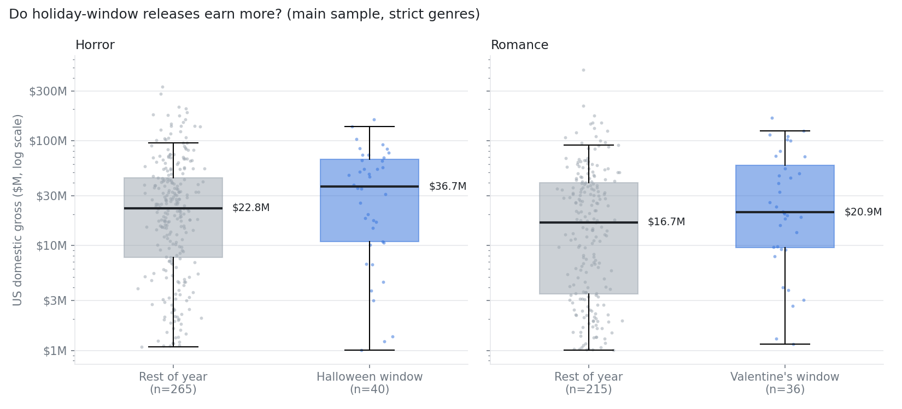
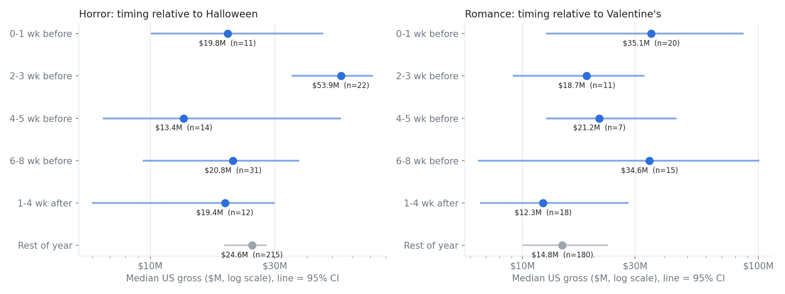

# Box Office Comparison

Generated October 20, 2026 by `src/11_boxoffice_comparison.py`.

Sample: 2,636 films with US gross of at least $1M, excluding re-releases. Horror and romance use the strict definition (tagged by both TMDB and IMDb). Window = released 0 to 28 days before the holiday. Confidence intervals come from 2,000 bootstrap resamples.

## 1. Window vs rest of year

| Genre | Window | Films in / out | Median gross in | Median gross out | Median ratio (95% CI) | Median ROI in / out | DiD premium (95% CI) |
|---|---|---|---|---|---|---|---|
| Horror | 28 days before Halloween | 40 / 265 | $36.7M | $22.8M | 1.61x (0.76-2.52) | 2.63 / 1.93 (n in = 38) | +131% (+42% to +277%) |
| Romance | 28 days before Valentine's | 36 / 215 | $20.9M | $16.7M | 1.25x (0.82-2.88) | 1.29 / 1.07 (n in = 35) | +111% (+26% to +255%) |

How to read:
- **Median ratio**: median gross of genre films in the window divided by the median for the same genre released at other times. A CI that includes 1.00 means no clear difference.
- **DiD premium**: difference in average log gross (window minus rest of year) for the genre, minus the same difference for all other films. This removes the general effect of that time of year. Expressed as a % change; a CI that includes 0% means no clear premium.

## 2. Does timing within the season matter?

| Genre | Release timing | Films | Median gross | 95% CI |
|---|---|---|---|---|
| Horror | 0-1 wk before | 11 | $19.8M | $10.1M to $45.7M |
| Horror | 2-3 wk before | 22 | $53.9M | $35.2M to $71.1M |
| Horror | 4-5 wk before | 14 | $13.4M | $6.6M to $53.6M |
| Horror | 6-8 wk before | 31 | $20.8M | $9.4M to $36.9M |
| Horror | 1-4 wk after | 12 | $19.4M | $6.0M to $29.8M |
| Horror | Rest of year | 215 | $24.6M | $19.3M to $27.8M |
| Romance | 0-1 wk before | 20 | $35.1M | $12.7M to $85.9M |
| Romance | 2-3 wk before | 11 | $18.7M | $9.2M to $32.7M |
| Romance | 4-5 wk before | 7 | $21.2M | $12.7M to $44.7M |
| Romance | 6-8 wk before | 15 | $34.6M | $6.5M to $100.0M |
| Romance | 1-4 wk after | 18 | $12.3M | $6.7M to $27.9M |
| Romance | Rest of year | 180 | $14.8M | $10.1M to $22.9M |

## 3. Robustness checks

| Variant | Genre | Films in window | Median ratio | DiD premium |
|---|---|---|---|---|
| Main (28-day window) | Horror | 40 | 1.61x (0.75-2.46) | +131% (+39% to +280%) |
| Main (28-day window) | Romance | 36 | 1.25x (0.79-2.97) | +111% (+26% to +255%) |
| Dates agree within 7 days | Horror | 40 | 1.48x (0.73-2.40) | +118% (+33% to +262%) |
| Dates agree within 7 days | Romance | 35 | 0.86x (0.65-2.12) | +73% (+1% to +184%) |
| 35-day window | Horror | 47 | 1.49x (0.67-2.35) | +98% (+25% to +210%) |
| 35-day window | Romance | 38 | 1.25x (0.80-2.75) | +86% (+14% to +202%) |
| 42-day window | Horror | 56 | 0.91x (0.60-1.83) | +45% (-7% to +123%) |
| 42-day window | Romance | 39 | 1.33x (0.85-2.54) | +86% (+14% to +193%) |
| Gross >= $100K | Horror | 47 | 1.47x (0.61-3.00) | +135% (+17% to +374%) |
| Gross >= $100K | Romance | 44 | 4.06x (1.42-6.83) | +143% (+20% to +371%) |
| Exclude pandemic years | Horror | 36 | 1.67x (0.88-2.46) | +147% (+46% to +297%) |
| Exclude pandemic years | Romance | 34 | 1.27x (0.76-3.03) | +116% (+30% to +261%) |

## Caveats

- Correlation, not causation: studios choose release dates, and stronger films may be placed in the holiday window.
- Small groups: only about 40 horror and 36 romance films fall in the main window, so intervals are wide.
- Gross is total domestic gross from OMDb, not inflation-adjusted. Medians and log gross limit the influence of outliers and small data errors.
