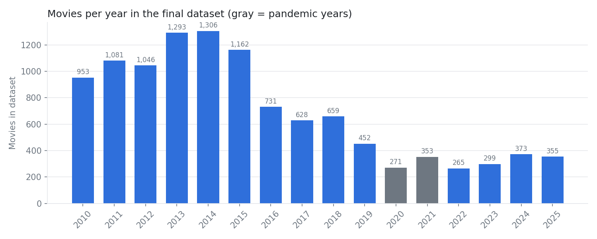
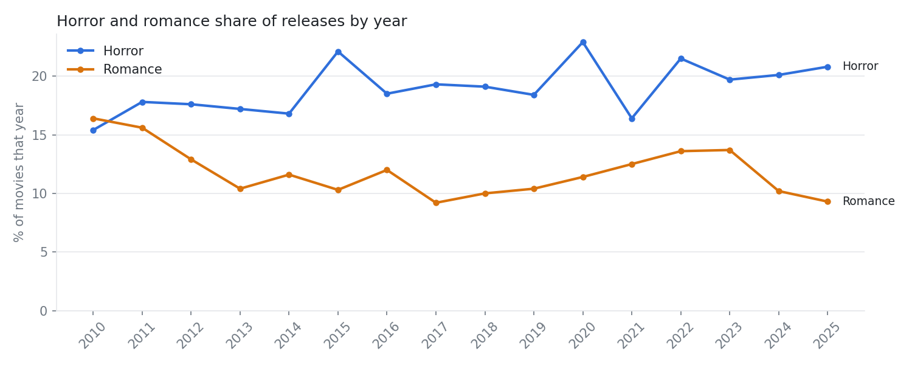

# Data Overview

Generated October 20, 2026 by `src/05_data_overview.py`.

## 1. Data scope

| Item | Choice |
|---|---|
| Source | TMDB API (The Movie Database, a community-maintained movie database) |
| Market | United States theatrical releases (TMDB release type "Theatrical") |
| Period | US theatrical release date from Jan 1, 2010 to Dec 31, 2025 |
| Unit | One row per film; release date = earliest US theatrical date |
| Inclusion rule | At least 10 TMDB user votes, to remove obscure titles with no activity |
| Exclusion rule | Release dates on Jan 1, which are usually placeholders rather than real dates |
| Genre definition | Multi-label: a film counts as horror if "Horror" appears anywhere in its TMDB genre list (same for romance) |
| Holiday windows | Released 0 to 28 days before Halloween (Oct 31) or Valentine's Day (Feb 14) |
| Release-calendar analyses | Exclude 2020-2021 (pandemic disruption) and documentaries (mostly small limited releases) |

### Sample funnel

| Step | Movies | % of raw |
|---|---|---|
| 1. TMDB US theatrical releases (raw pull) | 56,393 | 100.0% |
| 2. At least 10 TMDB votes | 11,436 | 20.3% |
| 3. US theatrical date within 2010-2025 | 11,315 | 20.1% |
| 4. Drop Jan 1 placeholder dates (final dataset) | 11,227 | 19.9% |
| 5. Release-calendar subset (no 2020-21, no documentaries) | 9,359 | 16.6% |

## 2. Sample overview

The final dataset has **11,227 films**, including **2,071 horror** (18.4%) and **1,348 romance** (12.0%) titles. 320 horror films fall in the Halloween window and 137 romance films fall in the Valentine's window. 71% of films carry more than one genre tag, which is why genres are treated as multi-label.

### Movies per year

| year | movies | horror | romance | horror_% | romance_% |
|---|---|---|---|---|---|
| 2010 | 953 | 147 | 156 | 15.4 | 16.4 |
| 2011 | 1,081 | 192 | 169 | 17.8 | 15.6 |
| 2012 | 1,046 | 184 | 135 | 17.6 | 12.9 |
| 2013 | 1,293 | 222 | 134 | 17.2 | 10.4 |
| 2014 | 1,306 | 219 | 152 | 16.8 | 11.6 |
| 2015 | 1,162 | 257 | 120 | 22.1 | 10.3 |
| 2016 | 731 | 135 | 88 | 18.5 | 12.0 |
| 2017 | 628 | 121 | 58 | 19.3 | 9.2 |
| 2018 | 659 | 126 | 66 | 19.1 | 10.0 |
| 2019 | 452 | 83 | 47 | 18.4 | 10.4 |
| 2020 | 271 | 62 | 31 | 22.9 | 11.4 |
| 2021 | 353 | 58 | 44 | 16.4 | 12.5 |
| 2022 | 265 | 57 | 36 | 21.5 | 13.6 |
| 2023 | 299 | 59 | 41 | 19.7 | 13.7 |
| 2024 | 373 | 75 | 38 | 20.1 | 10.2 |
| 2025 | 355 | 74 | 33 | 20.8 | 9.3 |

### Most common genres (multi-label, so shares add up to more than 100%)

| genre | movies | % of films |
|---|---|---|
| Drama | 4,451 | 39.6 |
| Comedy | 3,105 | 27.7 |
| Thriller | 2,643 | 23.5 |
| Horror | 2,071 | 18.4 |
| Action | 1,877 | 16.7 |
| Romance | 1,348 | 12.0 |
| Documentary | 1,296 | 11.5 |
| Adventure | 1,108 | 9.9 |
| Science Fiction | 1,058 | 9.4 |
| Crime | 1,058 | 9.4 |
| Family | 910 | 8.1 |
| Fantasy | 816 | 7.3 |

## 3. Genre distribution over time

Horror makes up 15.4% to 22.9% of films each year; romance ranges from 9.2% to 16.4%.

## 4. Field quality

| Field | Available | Missing % |
|---|---|---|
| US theatrical release date | 11,227 | 0.0% |
| Genres | 11,200 | 0.2% |
| IMDb ID (join key for box office) | 11,205 | 0.2% |
| MPA rating (G/PG/PG-13/R) | 6,828 | 39.2% |
| Runtime | 11,227 | 0.0% |
| Budget | 4,038 | 64.0% |
| Revenue (worldwide) | 4,241 | 62.2% |
| Production company | 10,054 | 10.4% |

Budget coverage by group:

| Group | Has budget % |
|---|---|
| All films | 36.0% |
| Horror | 35.7% |
| Romance | 36.8% |
| Franchise films | 58.9% |

## 5. Known limitations

1. **TMDB is not a complete list of US theatrical releases.** Film counts peak at 1,306 in 2014 and fall 65% by 2019, a pre-pandemic year with no comparable drop in the actual number of US releases. This likely reflects how TMDB contributors label release types over time (for example, recent small films released in theaters and on streaming at the same time). Year-over-year comparisons of counts should not be read as industry trends. Analyses here rely on within-year shares, and the box office data added later will define the final film universe.
2. **Genres are community-labeled.** Tagging standards vary between contributors, and the order of genres does not indicate the primary genre.
3. **Budget and revenue are incomplete.** Budget is missing for 64% of films, and revenue is worldwide rather than US. ROI analysis will use a smaller subsample; US box office will come from Box Office Mojo.
4. **"Theatrical" does not mean wide release.** TMDB's theatrical tag includes small releases. Wide release (600+ theaters) will be defined from box office data.
5. **Release dates are chosen by studios.** Any holiday-window differences are correlational, not causal.
