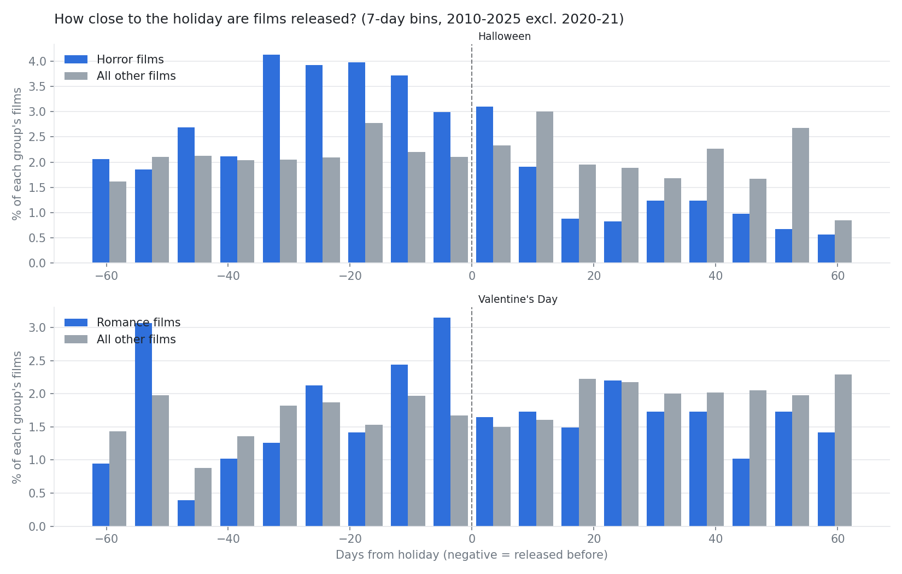
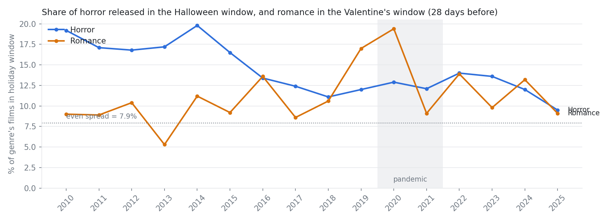

# Holiday Timing

Generated October 20, 2026 by `src/07_holiday_timing.py`.

Scope: 9,359 films (2010-2025 excluding 2020-2021 and documentaries). The trend table includes all years.
These results describe **release counts (studio scheduling)**, not box office performance.

## 1. How close to the holiday are films released?

| Genre | Holiday | Films released 1-63 days before | Median days before | Most common week before |
|---|---|---|---|---|
| Horror | Halloween | 532 | 27 | 5 |
| Romance | Valentine's Day | 201 | 25 | 1 |

## 2. Has holiday-window concentration changed over time?

If releases were spread evenly across the year, about 7.9% of any genre would land in a 28-day window.

| Year | Horror in Halloween window % | Romance in Valentine window % |
|---|---|---|
| 2010 | 19.2 | 9.0 |
| 2011 | 17.1 | 8.9 |
| 2012 | 16.8 | 10.4 |
| 2013 | 17.2 | 5.3 |
| 2014 | 19.8 | 11.2 |
| 2015 | 16.5 | 9.2 |
| 2016 | 13.4 | 13.6 |
| 2017 | 12.4 | 8.6 |
| 2018 | 11.1 | 10.6 |
| 2019 | 12.0 | 17.0 |
| 2020 | 12.9 | 19.4 |
| 2021 | 12.1 | 9.1 |
| 2022 | 14.0 | 13.9 |
| 2023 | 13.6 | 9.8 |
| 2024 | 12.0 | 13.2 |
| 2025 | 9.5 | 9.1 |

## 3. Competition inside the window

| Genre | Holiday window | Avg films in window per year | Avg per week, in window | Avg per week, rest of year | Busiest year |
|---|---|---|---|---|---|
| Horror | Halloween | 21.6 | 5.2 | 2.4 | 2014 (43) |
| Romance | Valentine's Day | 9.1 | 2.2 | 1.7 | 2014 (17) |

## 4. Is the holiday-window share significantly higher?

Two-proportion z-test comparing the genre's share of all releases inside the window vs the rest of the year.

| Test | In window | Rest of year | Difference (pts) | z | p-value |
|---|---|---|---|---|---|
| Horror share: Halloween window vs rest of year | 303/995 = 30.5% | 1635/8364 = 19.5% | +10.9 | 8.02 | <0.0001 |
| Romance share: Valentine's Day window vs rest of year | 127/724 = 17.5% | 1145/8635 = 13.3% | +4.3 | 3.23 | 0.0012 |

Caveat: the test treats each film as independent. Films cluster by studio strategy and year, so p-values are approximate.
