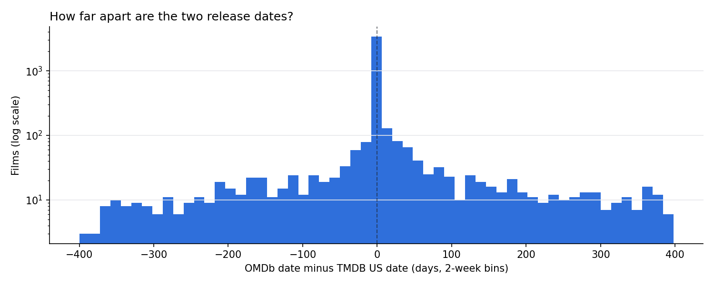

# Data Quality Check

Generated October 20, 2026 by `src/10_quality_check.py` on 4,761 films with US box office.

### A1. OMDb date minus TMDB US date

| index | films | % |
|---|---|---|
| OMDb 1y+ earlier | 95 | 2.0 |
| OMDb 2-12 mo earlier | 294 | 6.2 |
| OMDb 1-8 wk earlier | 190 | 4.0 |
| Within 1 week | 3483 | 73.3 |
| OMDb 1-8 wk later | 243 | 5.1 |
| OMDb 2-12 mo later | 323 | 6.8 |
| OMDb 1y+ later | 123 | 2.6 |
| OMDb date missing | 10 | 0.2 |

### A2. Mismatch rate by TMDB release type

| us_release_type | films | mismatch_pct | median_gap_days |
|---|---|---|---|
| 3 = theatrical | 4751 | 17.6 | 0.0 |

### A3. Mismatch rate by gross tier

| gross_tier | films | mismatch_pct |
|---|---|---|
| <$1M | 2104 | 32.9 |
| $1-10M | 919 | 14.0 |
| $10-50M | 908 | 1.5 |
| $50-100M | 403 | 0.0 |
| $100M+ | 417 | 0.0 |

### A4. Holiday-window status under each date source

| Genre | In window (TMDB date) | In window (OMDb date) | In both | Only TMDB | Only OMDb |
|---|---|---|---|---|---|
| Horror | 71 | 62 | 60 | 11 | 2 |
| Romance | 80 | 81 | 67 | 13 | 14 |

### A5. 20 largest date gaps (check by eye)

| title | us_date | omdb_date | date_gap_days | us_release_type | gross_m |
|---|---|---|---|---|---|
| The Lovely Month of May | 2013-09-13 | 1963-05-01 | -18398.0 | 3 | 0.06 |
| The Great Silence | 2012-09-09 | 1969-01-27 | -15931.0 | 3 | 0.05 |
| Time Masters | 2024-07-26 | 1984-07-20 | -14616.0 | 3 | 0.04 |
| The King and the Mockingbird | 2014-11-21 | 1980-03-19 | -12665.0 | 3 | 0.03 |
| Grave of the Fireflies | 2018-08-12 | 1989-07-26 | -10609.0 | 3 | 0.52 |
| Kiki's Delivery Service | 2019-07-28 | 1990-12-20 | -10447.0 | 3 | 3.7 |
| Princess Mononoke | 2022-04-03 | 1997-07-12 | -9031.0 | 3 | 12.54 |
| Spirited Away | 2025-10-18 | 2003-03-28 | -8240.0 | 3 | 14.82 |
| Time of the Wolf | 2021-12-21 | 2003-10-08 | -6649.0 | 3 | 0.06 |
| Level Five | 2014-08-15 | 1997-02-19 | -6386.0 | 3 | 0.03 |
| Cave of Forgotten Dreams | 2010-11-03 | 2026-04-24 | 5651.0 | 3 | 5.43 |
| Ek Tha Tiger | 2012-08-17 | 2025-12-27 | 4880.0 | 3 | 2.35 |
| Dhoom 3 | 2013-12-20 | 2025-11-28 | 4361.0 | 3 | 8.03 |
| Smash His Camera | 2010-07-30 | 2022-05-02 | 4294.0 | 3 | 0.0 |
| Miss Minoes | 2011-12-23 | 2001-12-06 | -3669.0 | 3 | 0.27 |
| Home Run | 2013-04-19 | 2022-11-15 | 3497.0 | 3 | 2.86 |
| 50 to 1 | 2014-03-21 | 2023-05-01 | 3328.0 | 3 | 1.06 |
| If I Were You | 2013-03-15 | 2021-08-12 | 3072.0 | 3 | 0.01 |
| A Silent Voice: The Movie | 2024-12-15 | 2016-09-17 | -3011.0 | 3 | 1.08 |
| The Pretty One | 2014-02-07 | 2022-01-01 | 2885.0 | 3 | 0.01 |

### B. Sample size by minimum gross

| Min gross | Films | Horror | Horror in Halloween window | Romance | Romance in Valentine window | With budget |
|---|---|---|---|---|---|---|
| $1 | 4761 | 548 | 71 | 663 | 80 | 2807 |
| $100,000 | 3575 | 407 | 52 | 490 | 58 | 2588 |
| $1,000,000 | 2648 | 342 | 44 | 352 | 46 | 2299 |
| $10,000,000 | 1728 | 249 | 36 | 212 | 34 | 1695 |

### C. Share of films vs share of box office by tier

| gross_tier | films | total_gross_m | % of films | % of total gross |
|---|---|---|---|---|
| <$1M | 2114 | 364.0 | 44.4 | 0.2 |
| $1-10M | 919 | 3442.0 | 19.3 | 2.4 |
| $10-50M | 908 | 23834.0 | 19.1 | 16.3 |
| $50-100M | 403 | 28048.0 | 8.5 | 19.2 |
| $100M+ | 417 | 90504.0 | 8.8 | 61.9 |

### D1. Horror label agreement (TMDB vs IMDb)

| Check | Films |
|---|---|
| TMDB Horror | 548 |
| IMDb Horror | 519 |
| Both | 481 |
| TMDB only | 67 |
| IMDb only | 38 |
| TMDB Horror also tagged Family/Animation/Comedy | 87 |
| Horror strict (TMDB and IMDb, no Family/Animation) | 481 |

### D2. Romance label agreement (TMDB vs IMDb)

| Check | Films |
|---|---|
| TMDB Romance | 663 |
| IMDb Romance | 609 |
| Both | 461 |
| TMDB only | 202 |
| IMDb only | 148 |

### D3. Top-grossing 'horror' films also tagged Family/Animation/Comedy

| title | genres | omdb_genre | gross_m |
|---|---|---|---|
| Goosebumps | Adventure|Horror|Comedy | Animation, Adventure, Comedy | 80.1 |
| Boo! A Madea Halloween | Comedy|Horror | Comedy, Drama, Horror | 73.2 |
| Zombieland: Double Tap | Comedy|Horror | Action, Comedy, Horror | 73.1 |
| The House with a Clock in Its Walls | Comedy|Family|Fantasy|Horror|Mystery | Comedy, Family, Fantasy | 68.5 |
| Warm Bodies | Horror|Comedy|Romance|Science Fiction | Action, Adventure, Comedy | 66.4 |
| Anaconda | Adventure|Comedy|Horror | Action, Adventure, Comedy | 65.1 |
| Happy Death Day | Comedy|Horror|Mystery | Comedy, Horror, Mystery | 55.7 |
| Boo 2! A Madea Halloween | Comedy|Horror | Comedy, Drama, Horror | 47.3 |
| Goosebumps 2: Haunted Halloween | Comedy|Fantasy|Horror|Family | Adventure, Comedy, Fantasy | 46.7 |
| Krampus | Horror|Comedy|Fantasy | Comedy, Fantasy, Horror | 42.7 |

### E. Top 15 domestic grosses (compare with a trusted source by hand)

| title | year | gross_m |
|---|---|---|
| Star Wars: The Force Awakens | 2015 | 936.7 |
| Avengers: Endgame | 2019 | 896.1 |
| Spider-Man: No Way Home | 2021 | 814.9 |
| Top Gun: Maverick | 2022 | 722.0 |
| Black Panther | 2018 | 700.4 |
| Avatar: The Way of Water | 2022 | 688.5 |
| Avengers: Infinity War | 2018 | 678.8 |
| Jurassic World | 2015 | 653.4 |
| Inside Out 2 | 2024 | 653.0 |
| Deadpool & Wolverine | 2024 | 636.7 |
| Barbie | 2023 | 636.2 |
| The Avengers | 2012 | 623.4 |
| Star Wars: The Last Jedi | 2017 | 620.2 |
| Incredibles 2 | 2018 | 608.6 |
| The Super Mario Bros. Movie | 2023 | 574.9 |

