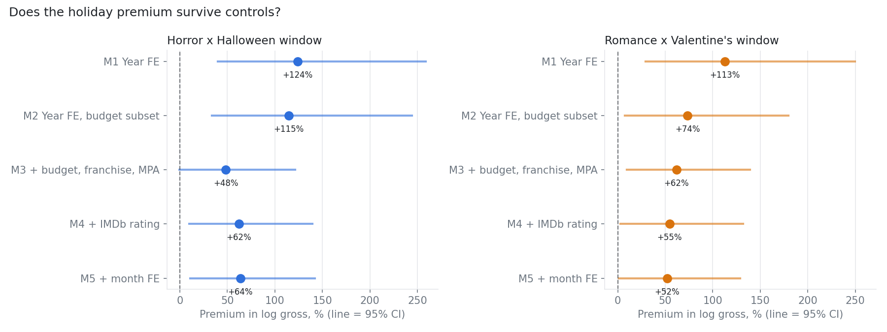

# Regression and Controls

Generated October 20, 2026 by `src/12_regression.py`.

Main sample: 2,636 films (gross >= $1M, no re-releases). Models M2 to M5 use the 2,289 films with known budget and IMDb rating. Strict genres; window = 0 to 28 days before the holiday. Robust (HC1) standard errors.

## 1. What drives the DiD premium?

| Genre | Genre: window vs rest | Others: window vs rest | DiD (genre minus others) |
|---|---|---|---|
| Horror | +32% | -43% | +131% |
| Romance | +66% | -21% | +111% |

| Comparison | Group | Timing | Films | Median gross | Mean log gross |
|---|---|---|---|---|---|
| Horror vs others | Horror | Halloween window | 40 | $36.7M | 17.02 |
| Horror vs others | Horror | Rest of year | 265 | $22.8M | 16.74 |
| Horror vs others | All other films | Halloween window | 200 | $11.3M | 16.24 |
| Horror vs others | All other films | Rest of year | 2131 | $24.1M | 16.81 |
| Romance vs others | Romance | Valentine's window | 36 | $20.9M | 16.87 |
| Romance vs others | Romance | Rest of year | 215 | $16.7M | 16.37 |
| Romance vs others | All other films | Valentine's window | 189 | $19.1M | 16.57 |
| Romance vs others | All other films | Rest of year | 2196 | $23.4M | 16.81 |

## 2. Holiday premium with controls

The premium is the coefficient on genre x window: how much more (in %) a matched-genre film in the window earns, beyond the genre's usual level and beyond the window's effect on other films.

| Genre | Model | Films | Genre films in window | Premium (genre x window) | 95% CI | p-value | R2 |
|---|---|---|---|---|---|---|---|
| Horror | M1 Year FE | 2636 | 40 | +124% | +40% to +259% | <0.001 | 0.02 |
| Horror | M2 Year FE, budget subset | 2289 | 38 | +115% | +34% to +244% | 0.001 | 0.02 |
| Horror | M3 + budget, franchise, MPA | 2289 | 38 | +48% | -1% to +122% | 0.054 | 0.53 |
| Horror | M4 + IMDb rating | 2289 | 38 | +62% | +10% to +140% | 0.015 | 0.56 |
| Horror | M5 + month FE | 2289 | 38 | +64% | +11% to +142% | 0.013 | 0.56 |
| Romance | M1 Year FE | 2636 | 36 | +113% | +29% to +250% | 0.003 | 0.02 |
| Romance | M2 Year FE, budget subset | 2289 | 35 | +74% | +8% to +180% | 0.024 | 0.02 |
| Romance | M3 + budget, franchise, MPA | 2289 | 35 | +62% | +10% to +139% | 0.016 | 0.51 |
| Romance | M4 + IMDb rating | 2289 | 35 | +55% | +3% to +132% | 0.036 | 0.54 |
| Romance | M5 + month FE | 2289 | 35 | +52% | +1% to +129% | 0.044 | 0.54 |

### Control variables (model M4)

| Genre model | Control | Effect | p-value |
|---|---|---|---|
| Horror | log budget (1% more budget) | 0.56% gross per 1% budget | <0.001 |
| Horror | Franchise film | +131% | <0.001 |
| Horror | IMDb rating (+1 point) | +34% | <0.001 |
| Romance | log budget (1% more budget) | 0.53% gross per 1% budget | <0.001 |
| Romance | Franchise film | +158% | <0.001 |
| Romance | IMDb rating (+1 point) | +26% | <0.001 |

## 3. Horror release timing with controls (horror films only)

Compared with horror released at other times of year, controlling for year, budget, franchise, MPA rating and IMDb rating.

| Horror released | Films | vs rest of year | 95% CI | p-value |
|---|---|---|---|---|
| 0-1 wk before | 10 | -21% | -48% to +20% | 0.265 |
| 2-3 wk before | 22 | +19% | -21% to +81% | 0.408 |
| 4-5 wk before | 13 | -15% | -50% to +44% | 0.546 |
| 6-8 wk before | 28 | -5% | -35% to +39% | 0.801 |
| 1-4 wk after | 12 | -39% | -64% to +4% | 0.068 |

## Caveats

- Observational data: controls reduce but do not remove the bias from studios choosing release dates.
- IMDb rating is measured after release and may partly reflect box office success, so M4 and M5 may over-control.
- Small cells (about 30-40 films per genre in the window) give wide intervals.
